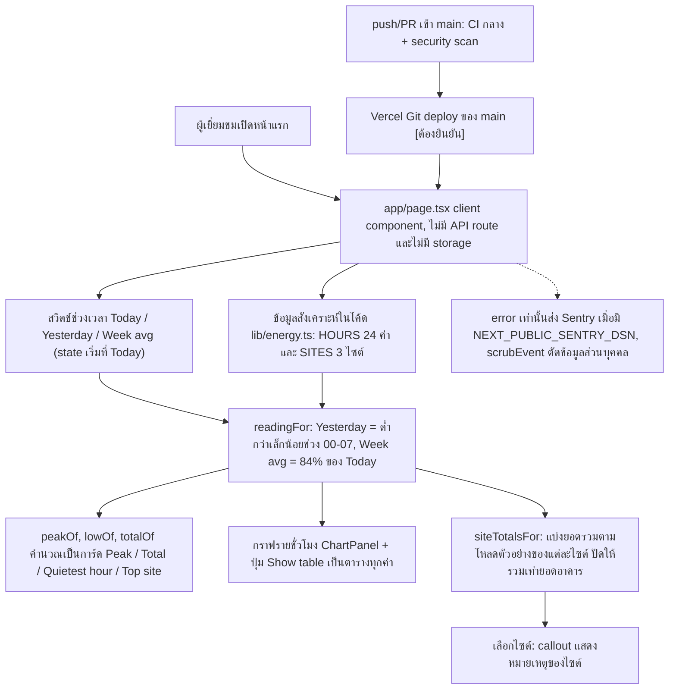

# 01 — Business process (As-Is / To-Be)

energy-dashboard-web คือแดชบอร์ดอ่านอย่างเดียวของเส้นโค้งโหลดไฟฟ้ารายชั่วโมงของอาคารหนึ่งหลัง (ข้อมูลสังเคราะห์) พร้อม 3 ไซต์ตัวอย่าง สำหรับผู้เยี่ยมชมที่อยากดูรูปแบบการแสดงผลข้อมูลพลังงาน ไม่ได้เชื่อมมิเตอร์หรือ API ใดๆ และคำนวณทั้งหมดในเบราว์เซอร์

Last reviewed: 2026-11-28 · commit `a766637`

## As-Is (จากโค้ดวันนี้)

Sources: `app/page.tsx`, `lib/energy.ts`, `components/dashboard-chart.tsx`, `components/dashboard-shell.tsx`, `lib/sentry.ts`, `instrumentation.ts`, `.github/workflows/ci.yml`, `PRODUCT.md`, `README.md`

## To-Be (ไม่มี To-Be ที่เขียนไว้)

ไม่มี To-Be ที่เขียนไว้

## Gap

| ID | As-Is → To-Be | Status | Owner | Evidence |
|---|---|---|---|---|
| G1 | เดโมข้อมูลสังเคราะห์ที่ไม่มี roadmap → ต้องการเป้าหมายที่เขียนไว้ (คงเป็นเดโม หรือเชื่อมแหล่งข้อมูลจริง) | decide | owner | `PRODUCT.md` ระบุว่าไม่มีมิเตอร์/API และไม่มีเป้าหมายถัดไป |

## Open questions

- `PRODUCT.md` อ้างถึงข้อความ "NOW / LOCAL 14:00 Tuesday" แต่ค้นไม่พบใน `app/`, `components/`, `lib/`: เอกสารน่าจะล้าหลังโค้ด
- สถานะ deploy จริงของ Vercel ยืนยันจากโค้ดไม่ได้ [ต้องยืนยัน]
